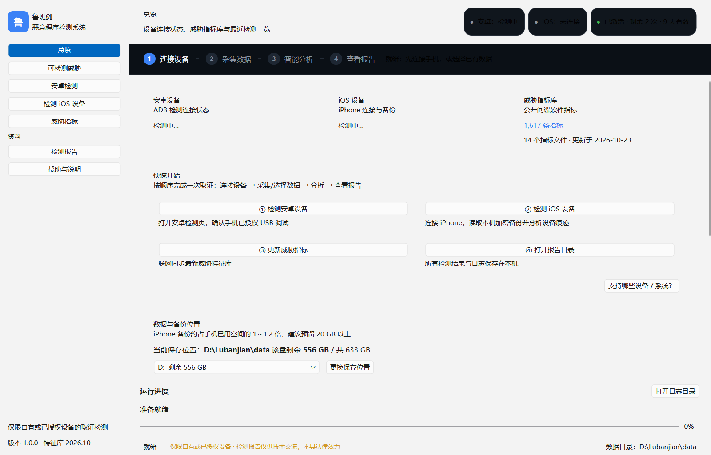
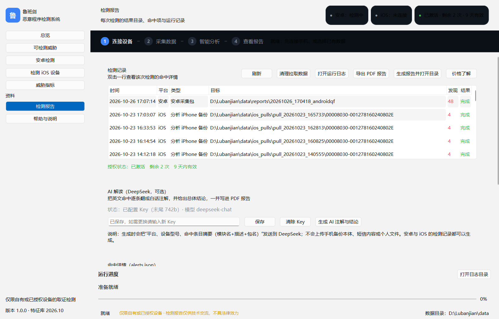
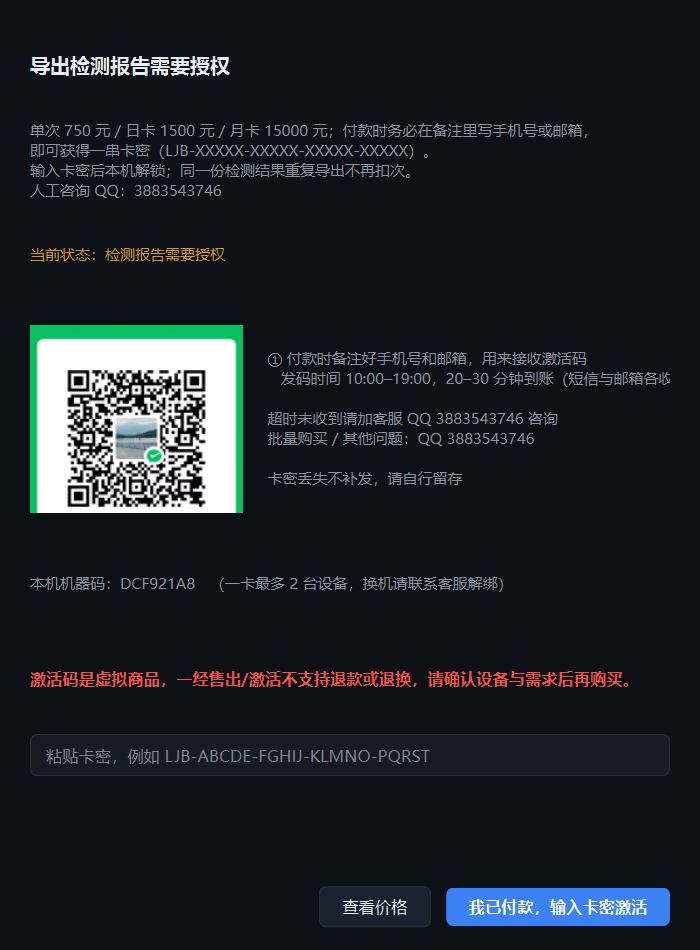

# 鲁班剑移动端恶意程序检测系统

**总结**：面向个人与企业的手机监听木马自查工具（Windows 桌面端）。用数据线连接手机后一键采集、
解析并与内置威胁指标比对，输出一份看得懂的中文 PDF 报告，帮助非技术用户判断手机是否被植入
监听、监控类恶意程序；除“更新指标 / 授权校验”外，采集与分析全部在本机完成。

> 仅限检测**本人所有或已获书面授权**的设备。报告仅供技术交流，不构成司法鉴定意见，不具法律效力。

## 能做什么

| 能力 | 说明 |
|---|---|
| 威胁指标库 | 内置公开网络情报指标（IOC），支持联网一键更新 |
| 中文报告 | 命中项逐条中文说明、标注应用名与证书来源，导出带水印的 PDF |
| AI 解读（可选） | 接入 DeepSeek，把英文技术条目翻译成白话并给出总体结论 |
| 结果保护 | 未授权状态下结果自动加密，激活后才可查看与导出 |
| 全离线可用 | 采集与分析在本机完成，除“更新指标/授权校验”外不联网 |

## 适用场景

- **自查手机是否被监听**：逐一核对应用权限、企业证书、描述文件、后台进程与可疑文件
- **验机 / 二手交易**：确认设备是否被装过监控类软件、是否残留可疑描述文件
- **企业设备合规**：批量检查员工机、测试机是否安装了未授权来源的应用

## 检测项（与报告第三章一致）

### 安卓设备（USB 连接，免 root）

| 检测项 | 内容 |
|---|---|
| 设备属性、系统设置 | 机型、系统版本、安全补丁、开发者选项与 USB 调试状态 |
| 已安装应用清单 | 包名、版本、安装来源（应用商店 / 未知来源 / 系统预装）、启用与停用状态 |
| 运行进程与服务 | 当前后台进程、常驻服务，识别异常自启动与守护进程 |
| 挂载信息与 root 迹象 | 分区挂载、su / Magisk 痕迹、系统分区是否被改写 |
| 系统诊断包（16 项） | 辅助功能服务、应用权限（AppOps）、设备管理器、广播接收器、ADB 状态、使用记录、电池统计、系统日志等 |
| 全盘文件清单 | 定位可疑落地文件、安装包残留与异常目录 |
| 应用数据备份 | `adb backup` 免 root 导出应用数据，用于短信、通讯录、聊天记录比对 |
| 系统入侵日志 | Android 13+ 高级保护模式提供的入侵记录（设备支持时才有） |

### iPhone（iOS）设备（加密备份解析，需信任电脑）

| 检测项 | 内容 |
|---|---|
| 备份元数据 | 设备名、型号、系统版本、IMEI / 序列号，用于确认报告对应的设备 |
| 已安装应用清单 | 全部应用及版本，标注**企业证书安装**与**非 App Store 来源** |
| 应用隐私授权（TCC） | 相机、麦克风、相册、定位、通讯录等授权记录，定位越权应用 |
| 定位服务客户端 | 哪些应用在持续请求定位 |
| 网络流量统计 | 按应用统计上行 / 下行流量，发现异常回传 |
| Safari / WebKit 记录 | 资源加载与会话记录，识别钓鱼页与异常跳转 |
| 短信与彩信附件 | 短信内容、发件号码与附件 |
| 通讯录与日历 | 联系人、日历事件（判断是否被同步外传） |
| 第三方应用数据 | WhatsApp 等应用的联系人与会话痕迹 |
| 系统分析日志 | 每日系统分析记录，辅助判断崩溃、注入与异常行为 |

> 以上检测项执行完毕后，结果与内置威胁指标（IOC）逐条比对，命中项按严重 / 高 / 中 / 低分级，
> 并在报告中标注对应应用名与证书来源；可选用 AI 生成中文注解与总体结论。

## 使用流程

1. **连接设备**：安卓开启 USB 调试；iPhone 信任本电脑
2. **一键采集**：程序自动完成数据提取与解析，界面显示简要进度
3. **自动比对**：与内置威胁指标库比对，列出命中项与风险等级
4. **生成报告**：导出 PDF（每页带“仅用于交流学习使用”水印 + 免责声明）
5. **AI 解读**（可选）：配置 DeepSeek Key 后，报告自动附中文注解与总体结论

## 授权与价格

单次 **750 元**（1 次报告）· 日卡 **1500 元**（24 小时不限次）· 月卡 **15000 元**（30 天不限次），
另有按“天数 + 次数”自定义的授权。

- 一张卡密最多可在 **2 台**电脑激活；同一台重装不占名额，换机联系客服解绑
- 结算点在**生成报告**：每生成一次报告扣 1 次，同一份结果重复导出不重复扣
- 限时卡出报告时需联网校验有效期；断网可在 12 小时内先出，联网后自动补报
- 次卡断网宽限 24 小时；换机重装联网后自动恢复云端余额
- 激活码为虚拟商品，一经售出/激活不支持退款或退换

付款时请在备注中写明**手机号或邮箱**，用于接收激活码；发放时间 10:00–19:00，20–30 分钟到账。
超时未收到请联系客服 QQ **3883543746**。

## 系统要求

- Windows 10 / 11（64 位），无需安装 Python 或驱动
- 安卓 7.0 及以上（需开启 USB 调试）
- iPhone：iOS 12 及以上，需在手机上点“信任此电脑”
- 建议预留 20 GB 磁盘空间（iPhone 备份占用较大），数据默认保存在非系统盘

## 下载与安装

在 **Releases** 页面下载：

| 文件 | 说明 |
|---|---|
| `Lubanjian-Setup-1.0.0.exe` | **安装版**，约 180 MB，带安装向导，内含完整程序 |
| `UserGuide-zh.txt` | 完整操作步骤与常见问题 |
| `cleanup.bat` / `cleanup.ps1` | 一键清理并卸载（换机或回收时用） |

**安装步骤**

1. 双击 `Lubanjian-Setup-1.0.0.exe`
2. 阅读并勾选同意《使用授权与免责声明》，点下一步
3. 选择安装目录（默认 `D:\鲁班剑`，建议非系统盘），点“开始安装”
4. 等待进度条走完，勾选“立即启动程序”点完成
5. 桌面与开始菜单自动生成快捷方式；卸载可在“设置 → 应用”中找到

首次启动需联网激活，激活码由客服提供。

## 常见问题

**Q：提示“未检测到设备”？**
安卓请确认数据线支持传输（非仅充电线）、已在开发者选项开启 USB 调试并在手机上点“允许”；
iPhone 请解锁后在弹窗点“信任”，并确认已安装苹果驱动（程序首次启动会提示）。

**Q：检测结果为空是不是就安全？**
不代表绝对安全。公开威胁指标只能覆盖已知样本，定向投放的定制木马可能不在库中。
建议结合系统权限、耗电与流量异常综合判断，必要时送专业机构取证。

**Q：报告能不能作为证据？**
不能。本工具输出的是技术自查结果，不具法律效力；如需司法用途请走正规电子数据取证流程。

## 免责声明（务必知晓的风险）

如使用本系统检测或可能引发使用者所谓**焦虑、恐慌、失眠**等心理反应，等任何不利影响，使用者知悉并确认：本系统检测结果仅作为交流学习使用，不构成任何医疗诊断、心理评估、法律意见或其他专业结论，其准确性、完整性及适用性存在固有局限。

在适用法律允许的最大范围内，因使用本系统（含相关设备）或依赖检测结果所产生的任何直接或间接后果、损失、损害及影响，均由使用者自行承担。使用者应基于自身情况独立判断并采取适当措施；如出现心理不适或关系影响，应及时寻求专业帮助。

使用者一经使用本系统或相关设备，即视为其已阅读、理解并同意本免责声明全部内容，并同意自行承担由此产生的一切后果与影响。
- 检测会读取手机数据，可能造成**发热、耗电、卡顿**，极端情况下**数据损坏或丢失**；由此产生的后果由使用者自行承担，**使用本设备即默认同意本免责声明**。
- 报告**仅供技术交流**，不构成司法鉴定意见，**不具法律效力**。

本工具仅供技术交流与个人设备安全自查使用，不提供任何形式的担保和承诺。
使用者应确保对被测设备拥有合法所有权或已获得明确授权，因不当使用产生的法律责任由使用者自行承担。
完整条款见程序首次启动时的《使用授权与免责声明》（帮助页可随时重看）。
